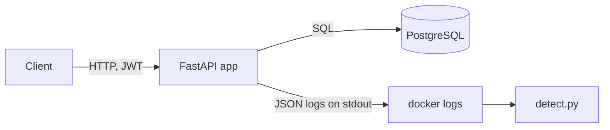

# Threat Model

STRIDE model of the fixed app (`main`) as it runs locally with Docker Compose.

## Data flow

A client logs in and gets a JWT (HS256, valid for 1 hour). Every other request
sends it, and the app scopes each query to the user id inside it. Orders and
withdrawals update the balance in a single transaction. A withdrawal pays out to
whatever IBAN is on the account at that moment (the bank side is simulated).
Security events are written to stdout as JSON and checked later by `detect.py`.

There are three trust boundaries:

1. Client to API. Everything in the request is untrusted, headers included.
   `X-Forwarded-For` is trusted only as far as `TRUSTED_PROXY_HOPS` allows, and
   `X-Client-Country` isn't verified at all.
2. API to database. Postgres isn't reachable from the host, only from the app.
3. API to logs. Logs are plain stdout with no integrity protection.

## STRIDE

| Area | STRIDE | Threat | Current state |
|---|---|---|---|
| Login | S | Credential stuffing, brute force | Fixed per IP: 5/min limit, bcrypt, detections. Still no MFA, and many IPs get around the limit |
| Login | S | Forged JWT | Fixed: the app won't start without a random secret of 32+ characters, and the algorithm is pinned |
| Login | S | Stolen token reused | Open. No logout or revocation, so a token works for its full hour |
| Login | I | Username enumeration | Open. `/register` replies "Username taken", and login skips bcrypt for unknown users, so timing can leak it |
| Login | D | bcrypt cost used to load the server | Reduced by the rate limit |
| Orders | T | Negative quantity mints money | Fixed (vulnerability 3): `gt=0` validation and a DB `CHECK` |
| Orders | T | Concurrent orders corrupt the balance | Fixed: row lock and `CHECK (balance >= 0)` |
| Orders | I | Reading other users' orders (IDOR) | Fixed (vulnerability 2). Walking ids is logged and detected but not throttled |
| Orders | R | Customer denies an order | Order row plus log with IP and user agent. Logs can be edited |
| Orders | D | Huge quantity overflows `NUMERIC(18,4)` | Open. No upper bound, the request ends in a 500 |
| Withdraw | T | Race condition pays out several times | Fixed (vulnerability 1): atomic conditional `UPDATE` |
| Withdraw | T | Retry pays twice | Fixed only when the client sends `Idempotency-Key`, which is optional |
| Withdraw | E | Whole balance drained at once | Open. No daily limit or hold on large payouts |
| IBAN | S, T | Takeover redirects payouts | Detected (takeover chain rule). Changing the IBAN needs no re-login, MFA or waiting period |
| IBAN | T | Invalid or foreign IBAN | Open. Any string is accepted |
| IBAN | I | IBANs exposed in logs | Fixed: logs keep only the country code and last 4 digits |
| Platform | E | Code execution in the container | Non-root, read-only fs, all capabilities dropped |
| Platform | E | App bug gives full DB control | Fixed: the app uses `miniapp_app`, which can't drop, delete or create anything, and can only append to orders and withdrawals |
| Platform | S | Spoofed client IP | Fixed if `TRUSTED_PROXY_HOPS` matches the real proxy chain |
| Platform | I | API docs public | Open. `/docs` and `/openapi.json` are served to anyone |
| Platform | I | Traffic sniffed | Open locally: plain HTTP, no TLS |
| Platform | T, R | Logs deleted or changed | Open. No central append-only store |
| Platform | T | Vulnerable dependency or leaked secret | CI runs Semgrep, Gitleaks and Trivy |

S = Spoofing, T = Tampering, R = Repudiation, I = Information disclosure,
D = Denial of service, E = Elevation of privilege.

## Known limitations in this demo

- `X-Client-Country` is set by the client. It stands in for a load balancer's
  geo header, so the "new country" part of the takeover rule can be faked here.
- There's no WAF or front end, so no TLS, bot protection or request size limits.
  Locally `TRUSTED_PROXY_HOPS=0` and `X-Forwarded-For` is ignored. A real
  deployment has to set it and check it with one real request.
- The rate limiter keeps counts in memory. They reset on restart, and with more
  than one instance each one has its own limit. Redis would fix that.
- Limits are per IP only. Per-account limits would slow distributed attacks but
  let someone lock a real customer out.
- IBAN changes and withdrawals only need a login. A real brokerage would ask for
  a second factor and delay payouts to a new IBAN.
- Detection runs over a saved log after the fact. Nothing alerts live or stops
  a payout.
- The bank is a database row, and all data is fake.
